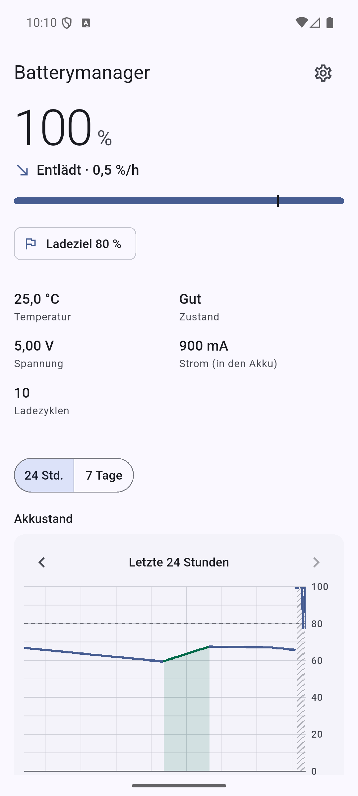
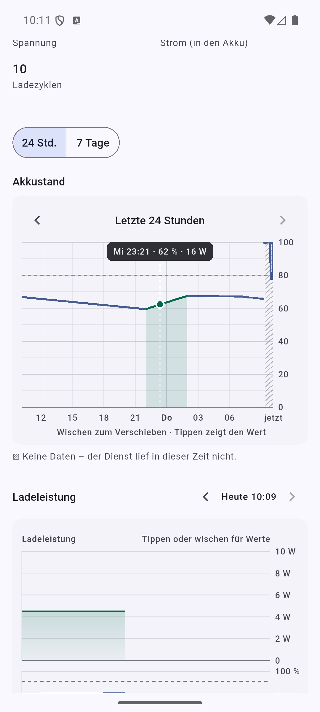
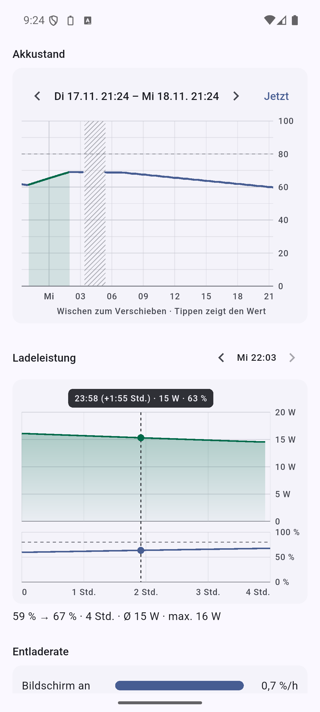
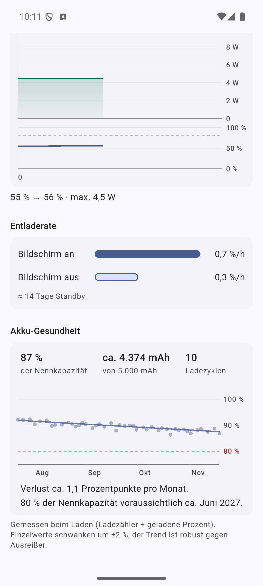
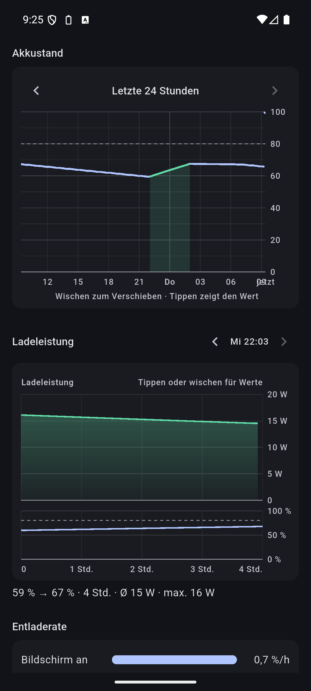

# Batterymanager

Deutsch | [English](#english)

Minimalistischer, stromsparender Akku-Monitor für **Android**. Eine Flutter-App für die Oberfläche, ein schlanker Kotlin-Hintergrunddienst ohne Flutter-Engine für die Messung. **Kein Internet, kein Konto, keine Telemetrie**: Alle Daten bleiben auf dem Gerät.

## Screenshots

<table>
  <tr>
    <td align="center" width="20%"><br><sub>Übersicht</sub></td>
    <td align="center" width="20%"><br><sub>Akkustand-Verlauf (Tippen zeigt den Wert)</sub></td>
    <td align="center" width="20%"><br><sub>Ladeleistung und Akkustand je Ladevorgang</sub></td>
    <td align="center" width="20%"><br><sub>Akku-Gesundheit mit Trend</sub></td>
    <td align="center" width="20%"><br><sub>Dunkelmodus</sub></td>
  </tr>
</table>

<sub>Aufgenommen im Emulator mit Demo-Daten.</sub>

## Funktionen

- **Live-Ladeanzeige** als Benachrichtigung: Ladestand, Leistung in Watt, Restzeit bis zum Ladeziel bzw. bis voll
- **Ladeziel mit Alarm** (Standard 80 %): Ton und Vibration genau einmal pro Ladevorgang, Erinnerung nach 10 Min.
- **Zusammenfassung nach dem Laden**, z. B. „23 % → 81 % in 52 Min. · Ø 15 W“
- **Akkustand-Verlauf** über 24 Std. oder 7 Tage, per Wischen bis 7 bzw. 30 Tage zurück verschiebbar, mit Hilfslinien alle 10 % und Lupe (Tippen zeigt Zeit, Stand und Leistung)
- **Ladeleistung je Ladevorgang**: Leistung als Fläche über der Zeit, darunter der Akkustand, mit Markierung, wann das Ladeziel erreicht war
- **Entladerate** in %/h (Bildschirm an/aus)
- **Akku-Gesundheit**: Kapazität wird bei jedem Ladevorgang gemessen (Ladezähler ÷ geladene Prozent). Ein robuster Trend (Theil-Sen) zeigt den Verlust pro Monat und wann voraussichtlich 80 % der Nennkapazität erreicht sind
- **Statusleiste nach Wahl**: Symbol aus (Standard), Watt und Restzeit dann nur beim Herunterziehen; ab Android 16 optional als Live-Chip mit Watt
- **Hitzewarnung** ab einstellbarer Akkutemperatur (40 / 45 / 50 °C)
- **Geräteprofil mit Selbsterkennung**: Einheit und Vorzeichen des Ladestroms sowie Zellenzahl werden automatisch gelernt und lassen sich manuell überschreiben
- **Lernende Restzeit** (läuft komplett auf dem Gerät): Aus früheren Ladevorgängen lernt die App, wie viel Energie jeder Prozentpunkt braucht und wie die Ladeleistung zum Ende hin abfällt. Zusammen mit der **aktuellen Wattzahl** gibt es so ab dem Einstecken eine Prognose bis zum Ziel bzw. Limit. Systematische Abweichungen früherer Prognosen werden automatisch ausgeglichen. Mit Konfidenzstufen („ca.“, „—“) statt falscher Genauigkeit
- Erkennt Ladepausen, Netto-Entladung am Kabel, Wackelkontakte (< 2 Min. zählt als dieselbe Sitzung) und Uhrsprünge
- **Zwei Betriebsmodi**: „Immer aktiv“ (empfohlen) oder „Nur beim Laden“
- Material You (dynamische Systemfarben ab Android 12), Hell/Dunkel

## Architektur

```
Flutter-UI (Prozess main)          Kotlin-Dienst (Prozess :monitor)
  features/  Übersicht, Einst.  ←→   MonitorService  (Foreground Service)
  core/      Modell, Controller       MonitorRuntime  (Engine, Sessions, Alarm, ETA)
  ui/        Diagramme, Theme         MonitorProvider (ContentProvider, Brücke)
        │                                   │
        └── liest read-only ────────►  SQLite (Rohwerte, Views normalisieren)
```

- Der Dienst läuft in einem eigenen Prozess **ohne Flutter-Engine**, damit der Eigenverbrauch minimal bleibt. Er reagiert nur auf Systemereignisse (`BATTERY_CHANGED`, `SCREEN_ON/OFF`), beim Entladen gibt es keine eigene Weckquelle.
- Die UI spricht über einen `MethodChannel` mit dem Dienst und liest die Verlaufsdaten **nur lesend** per `sqflite`.
- Rohwerte werden unverändert gespeichert und erst beim Lesen über SQL-Views mit dem Geräteprofil normalisiert. Fehlende oder unplausible Werte sind `null`, nie 0.
- Schema und Abfragen in `spec/db/` sind die einzige Schemaquelle für Dienst und UI.

Die verbindliche Beschreibung der Engine (Einheiten, Sampling, Sitzungs-Zustandsautomat, Ziel-Alarm, Restzeit, Geräteprofil) steht in [`spec/engine/spec.md`](spec/engine/spec.md). Die Golden-Fixtures in `spec/engine/fixtures/` decken Randfälle ab (Wackelkontakt, Ladepause, Zeitumstellung, Rekalibrierung, Dual-Cell u. a.).

## Datenschutz & Berechtigungen

Im Release-Build sind `INTERNET`, `WAKE_LOCK` und `SCHEDULE_EXACT_ALARM` bewusst entfernt, `allowBackup` ist aus.

| Berechtigung | Zweck |
|---|---|
| `POST_NOTIFICATIONS` | Live-Ladeanzeige, Alarm, Zusammenfassung |
| `FOREGROUND_SERVICE` (+ `SPECIAL_USE`) | Messung im Hintergrund |
| `RECEIVE_BOOT_COMPLETED` | Dienst nach Neustart bzw. App-Update wieder starten |
| `VIBRATE` | Vibration beim Ladeziel-Alarm |
| `REQUEST_IGNORE_BATTERY_OPTIMIZATIONS` | Verhindert, dass Android den Dienst beendet (besonders für „Nur beim Laden“) |

## Voraussetzungen

- Flutter (Dart SDK `^3.9.2`)
- Android-SDK, `minSdk 24`, `targetSdk 36`
- Android-Gerät oder Emulator (die Messung nutzt Android-Batterie-APIs)

## Entwickeln

```bash
flutter pub get
flutter test
flutter run
```

Die Tests prüfen das Datenbankschema samt SQL-Abfragen auf dem Rechner (`sqflite_common_ffi`) sowie die UI mit einem `FakeBackend`.

### Release

```bash
flutter build apk --release --split-per-abi
bash tool/check_release.sh
```

`tool/check_release.sh` prüft den Build gegen den Akzeptanzvertrag: App-ID `de.mlampert.batterymanager`, keine verbotenen Berechtigungen, `allowBackup=false`, nicht debuggable, `minSdk 24` / `targetSdk 36` und Signatur mit eigenem Release-Schlüssel statt Debug-Schlüssel (dafür `android/key.properties` anlegen).

## Projektstruktur

```
lib/
  core/      Backend-Schnittstelle, Controller, Modell, Formatierung
  features/  Onboarding, Übersicht, Einstellungen
  ui/        Diagramme, Theme
android/app/src/main/kotlin/de/mlampert/batterymanager/
  monitor/   Dienst, Engine, Benachrichtigungen, ContentProvider
  spike/     Mess-Spike zur Geräte-Charakterisierung (nur per adb)
spec/
  db/        SQL-Schema und Abfragen
  engine/    Engine-Spezifikation und Fixtures
tool/        Release-Check, Fixture-Generator
test/        Schema- und Widget-Tests
```

## Status

Frühe Version (`1.0.0+1`). Nur Android. Auswertung der Mess-Spikes auf realen Geräten: [`spec/spike-results.md`](spec/spike-results.md).

## Lizenz

Noch nicht festgelegt.

---

## English

# Batterymanager

A minimalist, low-power battery monitor for **Android**. The UI is a Flutter app; measurement is done by a lean Kotlin background service without a Flutter engine. **No internet, no account, no telemetry**: all data stays on the device.

### Screenshots

<table>
  <tr>
    <td align="center" width="20%"><br><sub>Overview</sub></td>
    <td align="center" width="20%"><br><sub>Charge history (tap shows the value)</sub></td>
    <td align="center" width="20%"><br><sub>Charging power and level per session</sub></td>
    <td align="center" width="20%"><br><sub>Battery health with trend</sub></td>
    <td align="center" width="20%"><br><sub>Dark mode</sub></td>
  </tr>
</table>

<sub>Taken in the emulator with demo data.</sub>

### Features

- **Live charging notification**: charge level, power in watts, remaining time to the charge target or to full
- **Charge target with alarm** (default 80 %): sound and vibration exactly once per charging session, reminder after 10 min
- **Summary after charging**, e.g. "23 % → 81 % in 52 min · avg 15 W"
- **Charge history** over 24 h or 7 days, swipe back up to 7 or 30 days, grid lines every 10 % and a magnifier (tap shows time, level and power)
- **Charging power per session**: power as an area over time with the charge level below and a marker for when the target was reached
- **Discharge rate** in %/h (screen on/off)
- **Battery health**: capacity is measured on every charge (charge counter ÷ percent charged). A robust trend (Theil–Sen) shows the loss per month and when 80 % of the design capacity is likely to be reached
- **Status bar your way**: no icon by default (watts and remaining time when you pull down the shade); optional live chip with watts on Android 16+
- **Heat warning** above an adjustable battery temperature (40 / 45 / 50 °C)
- **Device profile with auto-detection**: unit and sign of the charging current and cell count are learned automatically and can be overridden manually
- **Learning remaining-time estimate** (fully on-device): from past charging sessions the app learns how much energy each percent needs and how charging power tapers off near the end. Combined with the **current wattage** this gives a forecast to the target or limit right after plugging in. Systematic errors of earlier forecasts are corrected automatically. Confidence levels ("approx.", "—") instead of false precision
- Detects charging pauses, net discharge while plugged in, loose contacts (unplugged < 2 min counts as the same session) and clock jumps
- **Two operating modes**: "Always active" (recommended) or "Only while charging"
- Material You (dynamic system colors on Android 12+), light/dark

### Architecture

```
Flutter UI (process main)           Kotlin service (process :monitor)
  features/  overview, settings  ←→   MonitorService  (foreground service)
  core/      model, controller        MonitorRuntime  (engine, sessions, alarm, ETA)
  ui/        charts, theme            MonitorProvider (ContentProvider, bridge)
        │                                   │
        └── reads read-only ────────►  SQLite (raw values, views normalize)
```

- The service runs in its own process **without a Flutter engine** to keep its own power draw minimal. It only reacts to system events (`BATTERY_CHANGED`, `SCREEN_ON/OFF`); while discharging there is no wake-up source of its own.
- The UI talks to the service over a `MethodChannel` and reads history **read-only** via `sqflite`.
- Raw values are stored unchanged and normalized on read through SQL views using the device profile. Missing or implausible values are `null`, never 0.
- Schema and queries in `spec/db/` are the single source of truth for service and UI.

The binding engine specification (units, sampling, session state machine, target alarm, remaining time, device profile) is in [`spec/engine/spec.md`](spec/engine/spec.md) (German). The golden fixtures in `spec/engine/fixtures/` cover edge cases (loose contact, charging pause, DST, recalibration, dual-cell, etc.).

### Privacy & permissions

In the release build `INTERNET`, `WAKE_LOCK` and `SCHEDULE_EXACT_ALARM` are deliberately removed, and `allowBackup` is off.

| Permission | Purpose |
|---|---|
| `POST_NOTIFICATIONS` | Live charging display, alarm, summary |
| `FOREGROUND_SERVICE` (+ `SPECIAL_USE`) | Background measurement |
| `RECEIVE_BOOT_COMPLETED` | Restart the service after reboot or app update |
| `VIBRATE` | Vibration for the charge-target alarm |
| `REQUEST_IGNORE_BATTERY_OPTIMIZATIONS` | Keeps Android from killing the service (especially for "Only while charging") |

### Requirements

- Flutter (Dart SDK `^3.9.2`)
- Android SDK, `minSdk 24`, `targetSdk 36`
- Android device or emulator (measurement uses Android battery APIs)

### Development

```bash
flutter pub get
flutter test
flutter run
```

Tests check the database schema and SQL queries on the desktop (`sqflite_common_ffi`) and the UI with a `FakeBackend`.

#### Release

```bash
flutter build apk --release --split-per-abi
bash tool/check_release.sh
```

`tool/check_release.sh` verifies the build against the acceptance contract: app ID `de.mlampert.batterymanager`, no forbidden permissions, `allowBackup=false`, not debuggable, `minSdk 24` / `targetSdk 36`, and signed with an own release key instead of the debug key (create `android/key.properties` for that).

### Project structure

```
lib/
  core/      backend interface, controller, model, formatting
  features/  onboarding, overview, settings
  ui/        charts, theme
android/app/src/main/kotlin/de/mlampert/batterymanager/
  monitor/   service, engine, notifications, ContentProvider
  spike/     measurement spike for device characterization (adb only)
spec/
  db/        SQL schema and queries
  engine/    engine specification and fixtures
tool/        release check, fixture generator
test/        schema and widget tests
```

### Status

Early version (`1.0.0+1`). Android only. Results of the measurement spikes on real devices: [`spec/spike-results.md`](spec/spike-results.md).

### License

Not decided yet.
